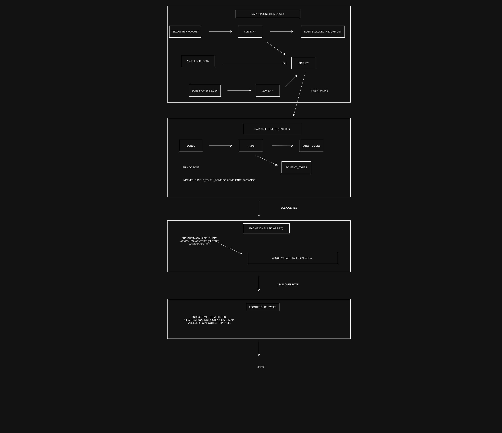

# Urban Mobility Data Explorer – NYC Yellow Taxis (Team 5)

## Links

- 📄 **Technical report:** https://docs.google.com/document/d/1UlUa6fpXzSfN7bVFvAnV0NbCPSVVVbMt/edit?usp=sharing&ouid=107451420785341530139&rtpof=true&sd=true
- 🎥 **Demo video:** https://drive.google.com/file/d/12MqG4yV5wkoaqsP-0CofeNzroZr7idyA/view?usp=drivesdk
- 🗄️ **Database (`taxi.db`):** https://drive.google.com/file/d/1WjSs7FqdrTCP6m_IcmjaSLiBE9lKAhoT/view?usp=sharing
- 📋 **Team task sheet:** https://docs.google.com/spreadsheets/d/1T7cVCOmTJQAJ7zTXjVJEGfDMyerL6sX9hO_09_UxPqE/edit?gid=0#gid=0

A full-stack app that cleans one month of New York City yellow-taxi trips (January 2019), stores them in a relational database, serves them through a Flask API and shows them on an interactive web dashboard.

**Dataset:** NYC Taxi & Limousine Commission (TLC) trip records – 7,667,792 raw trips → **7,555,500 trips after cleaning** (1.46% removed).

## Team

| Member | Responsibility |
|---|---|
| Eric Quagrainie | Data pipeline: zone boundaries, cleaning, database loading, styles |
| Sami (sotuagomah-git) | Database schema and Flask API |
| Michelle Odusanwo | Custom algorithm (hash table + min-heap) and dashboard frontend |

## Architecture



```
TLC raw files ──► zones.py / clean.py ──► load_db.py ──► SQLite (taxi.db)
                                                              │ SQL
                                                              ▼
                                         Flask API (app.py + algo.py)
                                                              │ JSON over HTTP
                                                              ▼
                                         Dashboard (index.html, charts.js, table.js, style.css)
```

## Folder structure

```
backend/
  zones.py        shapefile -> data/zones.geojson
  clean.py        cleans raw trips, logs every removed row
  load_db.py      builds database/taxi.db
  app.py          Flask API + serves the dashboard
  algo.py         custom hash table, min-heap and top-k routes
database/
  schema.sql      tables, foreign keys and indexes
  README.md       download link for taxi.db
frontend/
  index.html, style.css, charts.js, table.js
data/
  taxi_zone_lookup.csv, taxi_zones.*, zones.geojson
```

## Quick start (run the dashboard)

1. **Install** (Python 3.10+):
```
   python3 -m venv venv
   source venv/bin/activate          # Windows: venv\Scripts\activate
   pip install -r requirements.txt
```
2. **Get the database.** `taxi.db` is over 100 MB, so it is not in GitHub. Download it from Google Drive and save it as `database/taxi.db`:
   https://drive.google.com/file/d/1WjSs7FqdrTCP6m_IcmjaSLiBE9lKAhoT/view?usp=sharing
   (Or build it yourself – see *Data pipeline* below.)
3. **Start the server:**
```
   python backend/app.py
```
4. **Open** http://127.0.0.1:5000 in a browser. The first load can take a while because some queries scan all 7.5 million trips.

## Data pipeline

### 1. Put the raw data in `data/`
The zone files are already in the repo. Download the trip file from the NYC TLC Trip Record Data page:

| File | Save it as |
|---|---|
| Yellow taxi trips, January 2019 | `data/yellow_tripdata.parquet` |
| Taxi zone lookup (in repo) | `data/taxi_zone_lookup.csv` |
| Taxi zone shapefile (in repo) | `data/taxi_zones.shp`, `.shx`, `.dbf`, `.prj` |

If you downloaded the trips as a CSV, convert it once:
```
python -c "import pandas as pd; pd.read_csv('data/yellow_tripdata_2019-01.csv', low_memory=False).to_parquet('data/yellow_tripdata.parquet', index=False)"
```

### 2. Run the three scripts (from the project folder, in this order)
```
python backend/zones.py      # shapefile -> data/zones.geojson
python backend/clean.py      # -> data/clean_trips.parquet + logs/excluded_records.csv
python backend/load_db.py    # -> database/taxi.db (rebuilt from scratch each run)
```

### Cleaning rules
Every removed row is saved in `logs/excluded_records.csv` with a `reason` column.

| Rule | Rows removed | Why |
|---|---:|---|
| Missing time, distance, zone or fare | 0 | trip can't be used without them |
| Exact duplicate rows | 0 | same trip recorded twice |
| Pickup not in January 2019 | 537 | wrong meter clocks (dates from 2001 to 2088) |
| Duration under 1 min or over 3 hours | 94,888 | meter tests / meter left running |
| Distance 0 or over 100 miles | 11,429 | no movement, or meter errors |
| Fare 0 or less, or over $500 | 4,997 | refunds, voids and typos |
| Average speed over 80 mph | 441 | not possible in NYC traffic |
| Zone ID not in lookup table | 0 | can't be placed on the map |
| **Total** | **112,292** | |

**Assumptions:** passenger count 0 → 1 (117,381 trips); rate codes outside 1–6 → 99 "Unknown" (252 trips); payment types outside 0–6 → 5 "Unknown"; "N/A" boroughs/zones → "Unknown".

**Derived columns:** `duration_min`, `avg_speed_mph`, `fare_per_mile`, `pickup_hour`.

## Database

SQLite database `database/taxi.db`, defined in `database/schema.sql`:

| Table | Contents |
|---|---|
| `trips` | one row per cleaned trip (fact table) |
| `zones` | 265 taxi zones: borough, name, service zone, GeoJSON boundary |
| `rate_codes` | rate code descriptions |
| `payment_types` | payment type descriptions |

`trips.pu_zone_id` and `trips.do_zone_id` reference `zones.location_id`; `rate_code_id` and `payment_type_id` reference their lookup tables. Indexes on `pickup_ts`, `pu_zone_id`, `do_zone_id`, `fare_amount` and `trip_distance` speed up filtering and grouping.

## API

| Endpoint | Returns |
|---|---|
| `GET /api/summary` | total trips, average fare, distance and duration |
| `GET /api/hourly` | number of trips per pickup hour |
| `GET /api/zones` | trip counts per pickup zone |
| `GET /api/top-routes` | 10 busiest pickup → dropoff routes (custom algorithm) |
| `GET /api/trips` | 25 trips per page; filters `start`, `end`, `min_distance`, `max_distance`, `min_fare`, `max_fare`, `borough`; sorting `sort`, `order`; paging `page` |

Example: `/api/trips?borough=Manhattan&min_fare=20&sort=fare_amount&order=desc&page=1`

## Custom algorithm (`backend/algo.py`)

`/api/top-routes` finds the 10 most common (pickup zone, dropoff zone) pairs without using built-in counters or sorting:

1. A hand-written **hash table** (separate chaining, resizes at 75% load) counts trips per route – O(n) for n trips.
2. A hand-written **min-heap** of size k keeps only the k largest counts – O(m log k) for m distinct routes.
3. The heap is emptied into a list, largest first – O(k log k).

Total: **O(n + m log k)** time, **O(m)** extra memory.

## Dashboard

- Summary cards: trips, average fare, distance and duration
- Trips-by-hour bar chart
- Pickups by zone
- Top 10 busiest routes table